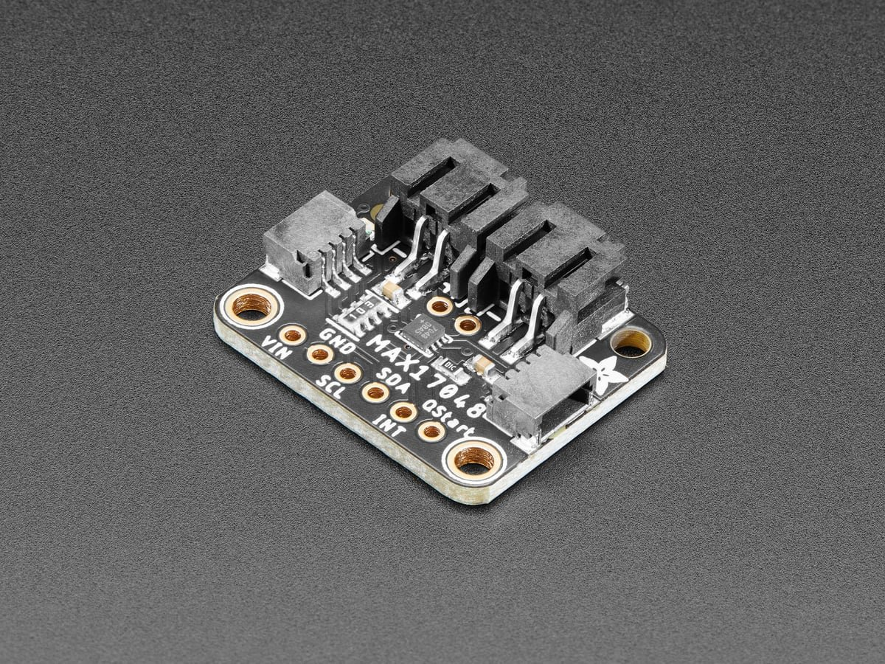

<p align="center">
  
  <br><sub>Adafruit MAX17048 breakout &mdash; photo <a href="https://www.adafruit.com/product/5580">Adafruit Industries</a></sub>
</p>

# mcu-battery

<p align="center">
  
  
  
</p>

A small C battery monitor library for **ESP-IDF 5.2+** and **STM32 HAL**:
chips that know they sit on a battery. One `struct battery_dev` gives pack
voltage, per-cell voltages, state of charge, current and temperature where
the chip has them, and its alerts by name. This library replaces
`esp-max17048-fuelgauge` and `esp-bq769x0-bms`, and keeps their
`max17048_init()` and `bq769x0_init()` APIs working unchanged.

The repository is named `mcu-battery`; the C API, `CONFIG_BATTERY_*`
options and forge package key are `battery`. The clone command below names
the ESP-IDF component directory `battery` as well.

> **Hardware unverified.** Host tests use simulated devices and platform stubs.
> Nothing here has run on a physical chip or a real pack.

[Supported hardware](#supported-hardware) · [Install](#install) ·
[Quick start](#quick-start) · [Examples](#examples) ·
[Documentation](#documentation) · [Tests](#tests)

## Supported hardware

Both drivers support both platforms. Enable only the ones you need.

| Chip | Bus | Kind | Reports |
|---|---|---|---|
| **MAX17048** | I2C, 0x36 | fuel gauge, one lithium cell | cell voltage, state of charge, charge rate |
| **BQ76920 / BQ76930 / BQ76940** | I2C, 0x08 or 0x18, CRC or not | cell monitor and protector, 3 to 15 cells | every cell, pack, current through a shunt, up to three thermistors; balancing, protection FETs |

**Where the line sits.** A chip belongs here when it knows it is on a
battery: it models the cell's charge (a gauge), or it measures cells one by
one and protects them (an AFE). A plain shunt and bus-voltage monitor such
as the INA226 stays in [mcu-powermon](https://github.com/JonasAtelier/mcu-powermon),
even when it is wired across a pack. See [chip reference](docs/chips.md#where-the-line-sits).

Wiring is in the [wiring guide](docs/hardware.md).

## Install

### ESP-IDF

Clone into your project's components directory:

```sh
git clone https://github.com/JonasAtelier/mcu-battery components/battery
```

Enable your chips in `idf.py menuconfig` → **Component config → Battery
monitor subsystem**, or add this to `sdkconfig.defaults` for the MAX17048:

```ini
CONFIG_BATTERY=y
CONFIG_BATTERY_MAX17048=y
```

The `main` component sees the library automatically. Other components declare
`REQUIRES battery driver` in `idf_component_register()`.

### esp-forge / stm-forge

Add to `profiles/pkgversion`:

```make
battery_GIT=https://github.com/JonasAtelier/mcu-battery@stable
```

Enable the package and your chip in `configs/<target>_defconfig`:

```make
PKG_battery         = y
BATTERY_MAX17048    = y
```

A target that used `PKG_max17048 = y` or `PKG_bq769x0 = y` swaps that line
for these two; its code builds unchanged. See
[installation](docs/installation.md#from-max17048-or-bq769x0).

### STM32 HAL without forge

Compile every `.c` under `src/`, chip folders included, add `include/` and
`src/` to the include path, and define `CMSIS_device_header` as your family
header, `USE_HAL_DRIVER`, and `CONFIG_BATTERY_<CHIP>=1` for each chip you
use. Enable and compile the HAL's I2C module.

**No chip driver is enabled by default.** See the
[installation guide](docs/installation.md).

## Quick start

Initialise the bus in your application, then open the chip with its own
call and read it through the battery API. This STM32 helper assumes the I2C
handle is already initialised:

```c
#include "battery.h"
#include "battery_log.h"
#include "max17048.h"

int read_once(I2C_HandleTypeDef *bus)
{
    static const max17048_config_t cfg = { .empty_alert_pct = 10 };
    max17048_handle_t gauge;
    struct battery_sample sample;
    int ret = max17048_init(bus, &cfg, &gauge);   /* 0x36 */
    if (ret)
        return ret;

    ret = battery_read(max17048_battery(gauge), &sample);
    if (!ret)
        battery_log_sample(max17048_battery(gauge), &sample);

    max17048_del(gauge);
    return ret;
}
```

On ESP-IDF, pass an `i2c_master_bus_handle_t`; there the chip calls return
`esp_err_t` as they always did, while `battery_read()` returns 0 or a
negative errno on both platforms.

- `battery_read()` returns volts, percent, amperes and °C; a quantity the
  chip does not measure is `NAN`. `cells` says how many `cell_v` entries are
  filled.
- `alerts` holds `BATTERY_ALERT_*` bits that latch in the chip until
  `battery_clear_alerts()`.
- What one chip alone has -- balancing, FETs, protection limits, RCOMP,
  quick start -- stays in its own header.

See [API usage](docs/usage.md) for lifetimes, the chip APIs, alerts and error
codes.

## Examples

| Chip | ESP-IDF | STM32 HAL |
|---|---|---|
| MAX17048 | [max17048](examples/esp/max17048/) | [max17048](examples/stm/max17048/main.c) |
| BQ769x0 | [bq769x0](examples/esp/bq769x0/) | [bq769x0](examples/stm/bq769x0/main.c) |

The ESP-IDF examples are the original repos' examples plus a battery API
read; `sdkconfig.defaults` turns each one's chip on. With ESP-IDF activated,
build from the example directory of a checkout named `battery`:

```sh
cd examples/esp/max17048
idf.py set-target esp32s3 # Replace with your board's target.
idf.py build
```

STM32 examples are snippets to integrate into your application, with clock
setup and logging retargeting provided by you.

## Scope and limitations

- **I2C only**, which is all these parts have. The bus layer also carries
  SPI and UART for future chips.
- **Blocking bus calls:** no interrupts or DMA, and no waits.
- **One task per handle:** the calls are not locked against each other.
- **No bus setup:** pins, clocks and speed are the app's.
- **Lithium safety is yours.** The BQ769x0 can switch a pack; read the
  [safety notes](docs/chips.md#safety) before wiring its FETs.

## Documentation

| Guide | Contents |
|---|---|
| [Installation](docs/installation.md) | Forge, ESP-IDF, STM32 HAL, build options, moving from `max17048` and `bq769x0` |
| [Hardware](docs/hardware.md) | Wiring, pins and addresses |
| [API usage](docs/usage.md) | Lifecycle, the chip APIs, alerts and errors |
| [Chip reference](docs/chips.md) | Where the line sits, what each chip reports, safety, provenance, changes from the originals |
| [Development](docs/development.md) | Repository layout, platform ports, bus abstraction, adding a chip, tests |

## Tests

```sh
make -C test test
```

Host-only tests use stubbed HAL and ESP-IDF APIs; no embedded toolchain or
physical chip is needed. See the [test reference](docs/development.md#tests).

## License

[MIT](LICENSE)
