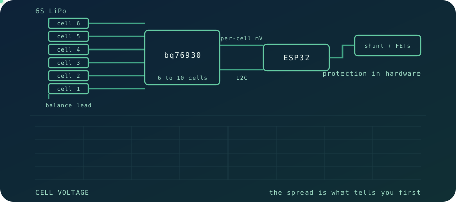

# Hardware wiring

[Back to README](../README.md)

Paths mentioned in this guide are relative to the repository root.

## Pins

The examples put SDA and SCL on GPIO 21 and 22 on ESP-IDF, and on PB9 and
PB8 (I2C1, AF4) on an STM32F4; any pins your chip routes to an I2C
peripheral work. Fit real 4.7 kΩ pull-ups; the internal ones are weak.

### MAX17048 — `examples/*/max17048`

| pin | goes to | note |
|---|---|---|
| VDD | the cell's positive terminal | the supply and the voltage-sense input; bypass with 0.1 µF to GND |
| CELL | the cell's positive terminal | not internally connected on the MAX17048 (the MAX17049's sense input) |
| GND | the cell's negative terminal, and the MCU's GND | shared ground, always |
| CTG, EP | GND | |
| SDA, SCL | the MCU's I2C pins | up to 400 kHz; `scl_hz` 0 picks 400 kHz on ESP-IDF, the handle's clock rules on the HAL |
| ALRT | nothing, or any input | optional: `max17048_read()` and `battery_read()` report the same over I2C. Open drain, active low: it wants a pull-up if wired |
| QSTRT | GND | driving it forces a quick start in hardware. Ground it, and call `max17048_quick_start()` deliberately if at all |

The address is fixed at 0x36 (p16). Pins as in the datasheet's pin table
(p6) and 1S application circuit (p15 Figure 14). Unplug the battery and the
gauge loses power with it, and everything it had learned about the cell; it
then comes back with RI set, which init handles.

**Single cell only.** For a series pack use the BQ769x0.

### BQ76920 / BQ76930 / BQ76940 — `examples/*/bq769x0`

Most of these go to the pack. Only four wires reach the MCU. Section and
table numbers are SLUSBK2I's, in `docs/bq769x0.pdf`.

| pin | goes to | note |
|---|---|---|
| SDA, SCL | the MCU's I2C pins | 100 kHz by default (`scl_hz` 0 on ESP-IDF); the part is not a fast-mode device |
| VSS | the MCU's GND | the bottom of the pack. The MCU has to share it or there is no bus |
| ALERT | any input, or nothing | fit a 500 kΩ–1 MΩ pull-down to VSS either way (8.3.1.3.4). High while any SYS_STAT bit is set: a fault, or a new coulomb count every 250 ms, which a read clears. The driver polls and never reads the pin |
| VC0 … VC15 | the cell taps, off the balance lead | **not simply VC0 up to VCn.** With fewer cells than the part has inputs, some inputs are shorted, per 9.1.8 Tables 9-2/9-3/9-4. Each set of five keeps its top input: 3S uses VC1, VC2, VC5; 6S on a '30 uses VC1, 2, 5, 6, 7, 10. The driver assumes that table for `cells`. Wired differently, or a '40 with 9 or 10 cells (Table 9-4: `0x4E73`, `0x4E77`), set `cell_channels` (bit 0 = VC1) |
| BAT | pack positive | where `pack_mv` is measured |
| SRP, SRN | the two ends of the sense resistor | no shunt, no current — `shunt_mohm` is that resistor's value |
| TS1 | a 10k NTC against the cells, to VSS | the driver selects the thermistor inputs, so an open TS1 gives `NAN` |
| TS2, TS3 | more 10k NTCs, TS2 to VC5x and TS3 to VC10x | '30 and '40 only for TS2, '40 only for TS3 (8.3.1.1.4). An unused input still needs a 10 kΩ resistor (9.1.6), and that reads as 25 °C |
| CHG, DSG | the FET gates, or nothing | leave them open and the part is a monitor; read [safety](chips.md#safety) first |

| Part | Cells |
|---|---|
| BQ76920 | 3 – 5 |
| BQ76930 | 6 – 10 |
| BQ76940 | 9 – 15 |

There is no address strap: the address is 0x08 or 0x18, with or without CRC,
burned in at the factory (Section 5), and `bq769x0_init()` works out which.
`REGSRC`, `REGOUT` and `CAP1` are the part's own regulator and bypass pins,
board wiring the driver never touches.

